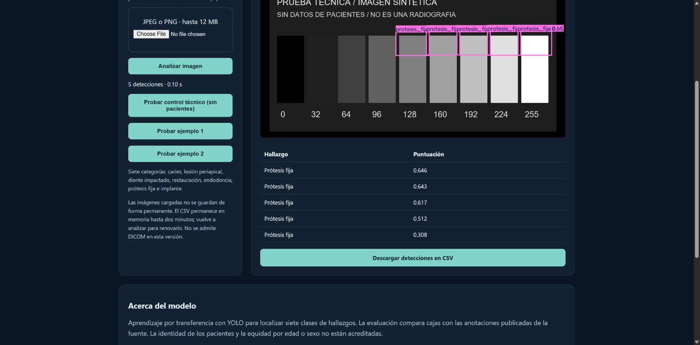

# Manual de usuario de Dental AI

Cristhian Pazmino Parra · Universidad Espíritu Santo · Maestría en Inteligencia Artificial

## Inicio

Desde la raíz del proyecto, ejecuta app/start.ps1 en PowerShell y abre http://127.0.0.1:8089. Mantén abierta la terminal. La aplicación comprueba los pesos, su hash y la taxonomía antes de indicar que el modelo está listo. El servidor funciona en este equipo; la dirección no es un sitio público.

La captura documental usa una entrada sintética identificada, sin datos de pacientes. Sirve para mostrar los controles; las métricas radiográficas proceden de la cohorte evaluada y no de ese patrón técnico.

## Analizar una panorámica

1. Selecciona un JPEG o PNG anonimizado de ocho bits por canal, una sola imagen, hasta 12 MB y veinte megapíxeles. DICOM no está admitido. La validación técnica no confirma que el contenido sea una panorámica dental.
2. Pulsa Analizar imagen y espera al indicador de procesamiento. Si ocurre un error, se muestra un mensaje y no se presenta una nueva salida como si fuera válida.
3. Revisa las cajas y la tabla. La puntuación indica confianza del detector, no probabilidad de enfermedad. El umbral fijado en validación es 0.15.
4. Descarga el CSV si necesitas las detecciones. El archivo contiene seis columnas y filas reales. Su enlace dura dos minutos: se conservan solo los datos de detecciones temporalmente en memoria, hasta 32 resultados; vuelve a analizar para renovarlo. Las coordenadas se expresan en píxeles de la imagen preparada, cuyas dimensiones se informan por la API, y no necesariamente de la original. Se conservan propuestas numéricas sin recorte previo a IoU; el dibujo se limita al área de imagen.

El botón **Probar control técnico (sin pacientes)** carga un patrón sintético incluido en el código y utiliza el mismo endpoint de carga. Las detecciones sobre ese patrón no tienen interpretación clínica. Los dos ejemplos radiográficos aparecen solo si existe el corpus local verificado. Para repetir los rechazos de formato y tamaño con archivos sintéticos generados en el navegador, abre **http://127.0.0.1:8089/?verify=1**. Este panel no necesita seleccionar archivos de tu disco ni cambiar permisos de la extensión.

La comprobación automatizada verificó las tablas de dos ejemplos, la respuesta del CSV descargada por HTTP y los rechazos del panel. Chrome no expuso eventos de descarga y no se verificó su carpeta de destino. La selección automática del archivo local requiere permiso de la extensión y no se completó; tampoco se acredita inspección visual móvil. El detalle está en reports/completion/browser_final.json.

Las categorías son caries, lesión periapical, diente impactado, restauración, endodoncia, prótesis fija e implante. Una imagen sin detecciones no descarta lesión. Esta versión se limita a investigación y educación no comercial con interpretación odontológica.

## Ejemplos y modelo

Los botones de ejemplo utilizan dos imágenes locales de validación cuando existe el corpus autorizado. No distribuyen una colección de radiografías a terceros. En una instalación sin corpus, la carga de archivos sigue disponible y los ejemplos no se anuncian como existentes. Acerca del modelo informa métricas de la versión cuyo hash coincide con los pesos cargados.

La aplicación usa YOLO11n a 960 píxeles. Prueba interna: mAP50 0,722; origen externo: 0,571. Esas cifras son respecto a anotaciones publicadas sin adjudicación local, no probabilidades ni certificación clínica. Los detalles por clase y denominadores están en la tesis.

## Errores frecuentes

| Mensaje o situación | Acción |
|---|---|
| Modelo no disponible | Comprueba models/research_v2/model.json y la existencia del checkpoint con el hash registrado. Usa el paquete correcto; no edites el hash para admitir pesos desconocidos. |
| Archivo incompatible | Usa una imagen estática JPEG/PNG de ocho bits. Renombrar una extensión no convierte el archivo. |
| Archivo demasiado grande | Exporta una copia autorizada compatible con el límite. Conserva el original y no presentes una imagen reducida como otra adquisición. |
| Ejemplo no disponible | La instalación no conserva el corpus autorizado o cambió un archivo. Carga una imagen propia autorizada; no descargues copias redistribuidas sin permiso. |
| No aparecen cajas | Revisa el umbral y los límites del modelo. No interpretes la ausencia como normalidad clínica. |
| Puerto ocupado | Cierra únicamente el proceso de esta aplicación que conozcas o inicia otra instancia con un puerto local libre. No termines procesos ajenos. |

## Privacidad y soporte

La inferencia es local y los archivos cargados no se guardan permanentemente. Comprueba anonimización antes de cargar: la máscara de bordes no garantiza retirar todo identificador. No uses el prototipo para decidir tratamientos o descartar patología.

Responsable académico y canal de soporte: Cristhian Pazmino Parra, mediante el canal de entrega del proyecto. Al informar un fallo, conserva versión, mensaje y pasos de reproducción sin enviar identificadores o imágenes de pacientes innecesarias. No se inventa una dirección de correo no proporcionada.
